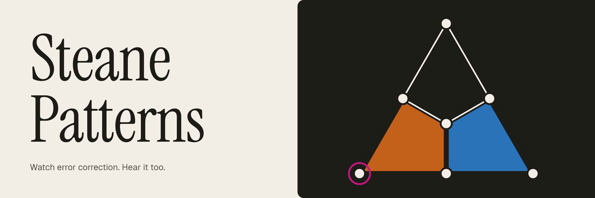
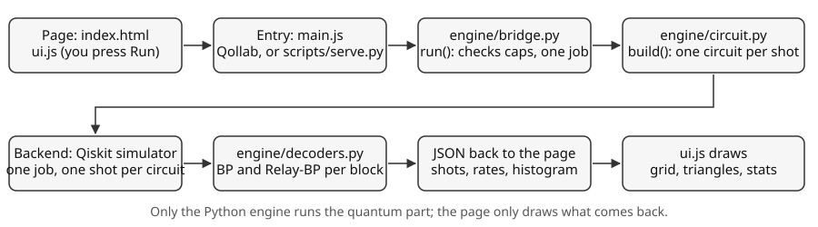

<p align="center">
  
</p>

**Watch quantum error correction work, and hear it.** Two logical qubits, each protected by a Steane [[7,1,3]] code, go through repeated rounds of error correction. Every parity-check readout is a cell in a grid (one row per round, one column per check), and each logical qubit is drawn as a triangle: 7 corners are data qubits, 3 faces are parity checks. Noise lights checks up, every lit check plays a note, and two decoders (plain belief propagation, BP, and **Relay-BP**) try to undo the damage.

Built for the Qollab × IonQ Global Quantum Hackathon, Oct 9–11 2026. An independent project: not affiliated with or endorsed by Qollab or IonQ. All product names belong to their owners.

## Use it

1. On Qollab, press **Run** with the **built-in Qiskit simulator** (IonQ is not supported, see *Limitations*).
2. Pick a logical circuit, a noise channel, the strength `p`, the rounds and the readout basis, then press **Run** in the page.
3. The grid plays one shot at a time. Read the **How to read this** box at the top of the page, or go to the **[documentation](src/docs/index.html)** (12 short chapters with diagrams and something to try in each).

Turn `p` up, listen to the music get denser, then watch BP fail before Relay-BP does. Use 192–256 shots to see the gap through the noise.

## How it works

How one Run travels through the code (the [shot flow](src/docs/04-rounds-grid.html) is in chapter 4):



- **Qubits.** Two Steane blocks need 14 data qubits. One ancilla is measured and reset after every check, so the circuit fits in 15 qubits for any number of rounds.
- **Circuit** (`engine/circuit.py`). Logical gates, encoding, rounds of checks, final readout. Every shot is its own circuit, sent in one job.
- **Noise** (`engine/noise.py`). Bit flip, depolarizing and SI1000 (circuit-level). Noise is sampled per shot and inserted as explicit Pauli gates.
- **Ground truth.** A Pauli frame (a record of the injected errors) is tracked through every gate, so each shot is judged exactly, not by a decoder.
- **Decoders** (`engine/decoders.py`). BP and Relay-BP work on a space-time check matrix, in plain numpy. The **limit** is the exact error rate of the best decoder that reads one error type at a time.

For the reasoning behind each part, read the docs: [syndromes](src/docs/03-syndromes.html), [noise models](src/docs/06-noise-models.html), [decoders](src/docs/08-belief-propagation.html), [limits](src/docs/12-limits.html).

## Limitations

- **IonQ backends are refused.** Repeated rounds need mid-circuit measurement and reset on one reused ancilla. IonQ documents mid-circuit measurement as supported on some targets and not others, and single-qubit reset as supported ([IonQ docs](https://docs.ionq.com/api-reference/v0.4/openqasm3)). The IonQ simulator supports it, and qiskit-ionq says QPU support is rolling out ([qiskit-ionq](https://github.com/qiskit-community/qiskit-ionq)). This project has never been run on IonQ, so it refuses every IonQ backend until a target is confirmed. Without the reuse, two Steane blocks need 26 qubits, above the 24-qubit statevector limit of Qiskit's `BasicSimulator`.
- Simulation is a full statevector, shot by shot. Rounds (max 5), shots (max 256) and `p` (0 to 0.1) are capped.
- Logical gates act before encoding only. Gates between rounds would need the decoders to track errors moving between blocks.
- For SI1000 no optimal-decoder limit is shown, because the decoders use only a rough model of that noise.

## Run it locally

```bash
pip install -r requirements.txt
python scripts/serve.py          # http://localhost:8000, optional port as argument
python -m engine.selfcheck       # the engine's assertions
python scripts/benchmark.py      # the decoder table in docs chapter 9 (fixed seed)
```

`scripts/serve.py` serves the same page and sends Run to a local `/run` endpoint, where native Python runs `engine.bridge.run` on the same simulator. The docs load KaTeX from a CDN, so the maths needs an internet connection. Opening `index.html` directly does not work, because `engine.bridge` only exists inside Qollab.

The circuit figures in `src/img/` are drawn from the code: `python scripts/make_diagrams.py` (needs matplotlib: `pip install -r requirements-dev.txt`).

## Files

```
index.html, main.js     Qollab entry points (stay at the root; main.js imports engine.bridge and passes `backend`)
requirements.txt        qiskit, numpy
engine/                 Python: steane, noise, circuit, decoders, bridge, selfcheck
src/js/                 ui.js, audio.js (app), steane-patterns.js (docs)
src/css/                tokens.css, main.css (app), docs.css (docs)
src/fonts/              Geist, Instrument Serif (+ licences)
src/docs/               the documentation (index.html, chapters, appendices)
src/img/                diagrams (SVG) used by the docs and README
scripts/                serve.py (local mode), benchmark.py (chapter 9 table), make_diagrams.py (figures)
```

## Credits

- Relay-BP: T. Müller et al., *Improved belief propagation is sufficient for real-time decoding of quantum memory*, 2025, [arXiv:2506.01779](https://arxiv.org/abs/2506.01779).
- SI1000: C. Gidney, M. Newman, A. Fowler, M. Broughton, *A fault-tolerant honeycomb memory*, Quantum 5, 605 (2021).

MIT licensed. Fonts (Geist, Instrument Serif) are under the SIL Open Font License 1.1; see `src/fonts/NOTICE.md`.
